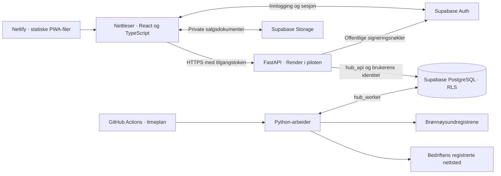
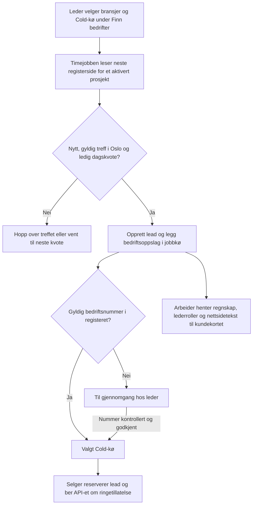

# Nexflow CRM

Nexflow er partnerhubens salgsverktøy. En selger velger prosjekt, åpner en ringekø, registrerer utfallet av samtalen og følger opp med møte eller salg. Prosjektledere fordeler arbeid, stiller inn bedriftssøk og følger resultatene i rapportene.

## Start lokalt

Bruk Node.js 22.12 eller nyere kompatibel LTS og Python 3.12. Kjør kommandoene fra prosjektroten. Eksemplene bruker PowerShell på Windows.

```powershell
npm.cmd ci --include=dev
npm.cmd run dev
```

Åpne [Nexflow på port 8087](http://127.0.0.1:8087) og velg **Åpne demonstrasjon**. Dette er den raskeste måten å lære arbeidsflyten på. Demoen bruker fiktive data i nettleserens minne. For å prøve innlogging, lagring og tilgangskontroll trenger du et eget Supabase-utviklingsprosjekt.

### Kjør med innlogging og database

1. Opprett et virtuelt Python-miljø og miljøfiler. Kommandoene bevarer eventuelle eksisterende miljøfiler.

   ```powershell
   python -m venv .venv
   .\.venv\Scripts\python -m pip install -r backend/requirements.lock
   .\.venv\Scripts\python -m pip install -e "backend[dev]"
   if (!(Test-Path backend/.env)) { Copy-Item backend/.env.example backend/.env }
   if (!(Test-Path frontend/.env.local)) { Copy-Item frontend/.env.example frontend/.env.local }
   ```

2. Fyll inn verdiene for utviklingsprosjektet. Nettleseren trenger `VITE_SUPABASE_URL`, `VITE_SUPABASE_PUBLISHABLE_KEY` og `VITE_API_URL=/api/v1`. Restart Vite etter endringer. Hver `VITE_`-variabel er lesbar i den bygde klienten.
3. Sett `SUPABASE_URL` og en administrativ `MIGRATION_DATABASE_URL` for utviklingsdatabasen. Kjør migrasjonene fra en egen terminal.

   ```powershell
   cd backend
   ..\.venv\Scripts\python -m alembic upgrade head
   ```

4. Opprett runtime-rollene og et aktivt prosjektmedlemskap som beskrevet i [driftsveiledningen](docs/drift.md#supabase-og-roller). Sett `DATABASE_URL` til API-brukerens forbindelse. Start API-et i samme terminal.

   ```powershell
   ..\.venv\Scripts\python -m uvicorn app.main:app --reload --port 8000
   ```

Vite videresender lokale forespørsler under `/api` til port 8000. [FastAPIs interaktive dokumentasjon](http://127.0.0.1:8000/docs) viser rutene og skjemaene. Ved «Ingen tilgjengelige prosjekter» etter innlogging, sjekk medlemskapet for brukerens Supabase-ID.

## Hvordan systemet henger sammen



**Tilgang.** Supabase Auth bekrefter identiteten. FastAPI verifiserer tokenet og kontrollerer prosjektmedlemskap og rolle for handlingen. Databasen bruker samme bruker-ID i radreglene (RLS). Identiteten settes for én transaksjon av gangen fordi en databaseforbindelse kan gjenbrukes av neste bruker. Migreringer, API og arbeider bruker hver sin databaseforbindelse med ulike rettigheter.

**Salg.** Klienten sender lead, produkt og en nøkkel for gjentatte forsøk. Serveren låser og kontrollerer reservasjonen, henter produktprisen og beregner fordelingen i øre. Salget lagrer både fordelingen og regelversjonen. Dermed beholder et tidligere salg riktig verdi når produktprisen eller provisjonen endres.

### Fra bedriftsregister til ringeliste



I pilotoppsettet er grensen **20 nye bedrifter per prosjekt og norsk kalenderdag**, inkludert kort til gjennomgang. Planlagt jobb starter ved minutt 17 hver time når workflowen er aktivert. Det enkelte kundekortet oppdateres normalt daglig. For å prøve én avgrenset runde i utviklingsdatabasen, sett `WORKER_DATABASE_URL` til den begrensede arbeiderbrukeren og kjør fra `backend`:

```powershell
..\.venv\Scripts\python -m app.worker --batch --discover --max-jobs 20 --max-seconds 120
```

## Hvor skal jeg endre koden?

| Oppgave | Start her | Følg videre til |
| --- | --- | --- |
| Endre navigasjon eller prosjektbytte | [Arbeidsflaten](frontend/src/App.tsx) | [Frontendkomponenter](frontend/src/components), [fiktive demodata](frontend/src/demo/workspace.ts) |
| Endre ringelisten eller et lead | [Ringeliste og tavle](frontend/src/components/LeadListPanel.tsx) | [Lead-ruter](backend/app/leads.py), [delte klienttyper](frontend/src/lib/crmTypes.ts) |
| Endre ringekø eller samtaleutfall | [Ringekøer i klienten](frontend/src/components/CallQueues.tsx) | [Køtildeling](backend/app/call_lists.py), [reservasjon og samtaler](backend/app/calls.py), [domeneregler](backend/app/domain.py) |
| Endre møtebooking eller salg | [Møtebooking](backend/app/booking.py), [registrering og godkjenning av salg](backend/app/sales.py) | [Møteutfall](backend/app/meeting_workflow.py), [salgsdokumenter](frontend/src/components/SaleDocuments.tsx) |
| Endre bransjevalg eller bedriftsoppslag | [Finn bedrifter](frontend/src/components/CompanyDiscovery.tsx), [søkeinnstillinger og gjennomgang](backend/app/discovery.py) | [Registerimport og dagskvote](backend/app/discovery_import.py), [arbeider](backend/app/worker.py), [registerkilder](backend/app/company_registry.py), [nettsteder](backend/app/company_site.py) |
| Endre roller eller lagrede felt | [Prosjekttilgang](backend/app/project_access.py), [databasesesjon](backend/app/db.py) | [SQLAlchemy-modeller](backend/app/models.py), [Pydantic-skjemaer](backend/app/schemas.py), [Alembic-migrasjoner](backend/migrations/versions) |
| Endre et rapporttall | [Definisjoner for rapporter](docs/reporting-and-follow-ups.md) | [Beregninger](backend/app/reporting.py), [rapportvisning](frontend/src/components/Reports.tsx) |
| Endre innlogging eller omvisning | [Innlogging](frontend/src/components/Login.tsx), [omvisning](frontend/src/components/WorkspaceTour.tsx) | [Stegene i hver visning](frontend/src/components/workspaceTourSteps.ts), [tokenvalidering](backend/app/auth.py) |
| Endre mobilvisning eller frakoblet oppstart | [Stilarkenes rekkefølge](frontend/src/main.tsx), [tilgjengelige dialoger](frontend/src/components/ui/dialog.tsx) | [Bygging av service worker](frontend/scripts/build-sw.mjs), [PWA-test](frontend/tests/pwa.spec.ts) |

Alle HTTP-rutere registreres i [FastAPI-applikasjonen](backend/app/main.py). Klientens [API-klient](frontend/src/lib/api.ts) legger tilgangstokenet på forespørselen. Start gjerne med å følge én handling fra en knapp, via ruten, til databasen og den tilhørende testen.

## Før en pull request

```powershell
npm.cmd run format:frontend
.\.venv\Scripts\ruff format backend
npm.cmd run check:format:frontend
.\.venv\Scripts\ruff format --check backend
npm.cmd run build
.\.venv\Scripts\python -m pytest backend/tests -q
npm.cmd run test:e2e
npm.cmd run test:pwa --workspace frontend
```

- **Database.** Testene for tilgangskontroll, samtidighet og økonomi trenger en separat, disponibel PostgreSQL-database. Kjør [testoppsettet](backend/tests/bootstrap_postgres.sql), migrer til `head` og sett `TEST_DATABASE_URL` til denne databasen. Uten den hopper Pytest over integrasjonstestene. Den komplette rekkefølgen er vist i [CI](.github/workflows/ci.yml).
- **Nettleser.** Playwright bruker Edge på Windows. På Linux bruker CI Chromium. Testene dekker skrivebord og emulert mobil. Bygg klienten før PWA-testen slik at service workeren finnes.
- **Ved kodeendringer.** Legg nye regler i modulen som eier arbeidsflyten. Kommenter hvorfor låsing, tilgang, tidsgrenser eller avrunding må fungere på en bestemt måte. Legg skjemaendringer i en ny migrasjon slik at miljøer som allerede er oppgradert, får samme endring.
- **Videre lesing.** [Arkitektur og sikkerhet](docs/architecture.md) · [Drift, Supabase, Render og Netlify](docs/drift.md) · [Kundekrav og leveransestatus](docs/requirements.md).
